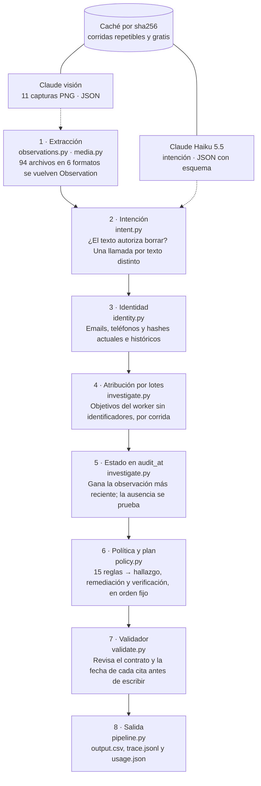

# Ghost Data Still Exists: ensayo técnico

Oct 25, 2026 · @Baruch Lopez

## 1. El problema y la tesis

Un borrado reportado como «Complete» no prueba que el dato desapareció. La solución trata ese estado como una afirmación y reconstruye, con evidencia, el estado real de cada copia a la hora `audit_at` de cada caso.

El reto modela un comercio ficticio. Los datos de una persona viven en la base de cuentas, réplicas, índices de búsqueda, tickets de soporte, exportaciones, analítica y respaldos. Además, sincronizaciones y restauraciones pueden recrear un dato que ya se había borrado en su origen.

La tesis de diseño tiene dos partes:

- **El estado lo deciden reglas deterministas** sobre observaciones extraídas de la evidencia, nunca el resultado que reporta un workflow.
- **El modelo de lenguaje solo percibe**: lee la intención de un texto libre y transcribe capturas de pantalla. Nunca escribe un paso ni elige una evidencia.

Con eso el sistema es reproducible, auditable y barato. En las 32 muestras públicas acierta los 32 estados, con un F1 de pasos de 98,7 %. Las 518 solicitudes de evaluación cuestan $0,0507 de modelo.

## 2. El contrato: qué entra, qué sale y cuándo

Cada solicitud trae `case_id, email, requested_at, reported_status, reported_at, audit_at, request_text`. El agente devuelve una fila `case_id, deletion_status, steps_json` por caso, 518 filas ordenadas por `case_id`.

El estado tiene tres valores. `NOT_APPLICABLE` va con `[]` cuando el texto no autoriza borrar. `COMPLETE` lleva solo pasos de verificación con evidencia. `INCOMPLETE` lleva hallazgos, el plan de remediación y las verificaciones futuras.

Cada paso tiene siete campos: `step_no, phase, system_id, resource_id, operation, state, evidence_id`. Las fases van siempre en orden `FINDING`, `REMEDIATION`, `VERIFICATION`, y `step_no` se numera desde 1. La remediación y las verificaciones futuras llevan `evidence_id` vacío, porque describen trabajo que aún no ocurre.

El vocabulario cerrado tiene 15 operaciones, cada una con un solo estado posible:

| Fase | Operación | Estado |
| --- | --- | --- |
| FINDING | `REPORT_REMAINING_RECORD` | PRESENT |
| FINDING | `REPORT_EXPOSED_PII` | PRESENT |
| FINDING | `REPORT_ACTIVE_DATA_FLOW` | ACTIVE |
| FINDING | `REPORT_RESTORE_RISK` | ACTIVE |
| REMEDIATION | `DISABLE_DATA_FLOW` | DISABLED |
| REMEDIATION | `BLOCK_RESTORE` | BLOCKED |
| REMEDIATION | `DELETE_RECORD` | ABSENT |
| REMEDIATION | `REDACT_RECORD` | REDACTED |
| REMEDIATION | `ANONYMIZE_RECORD` | ANONYMIZED |
| VERIFICATION | `VERIFY_RECORD_ABSENT` | ABSENT |
| VERIFICATION | `VERIFY_RECORD_PRESENT` | PRESENT |
| VERIFICATION | `VERIFY_RECORD_REDACTED` | REDACTED |
| VERIFICATION | `VERIFY_RECORD_ANONYMIZED` | ANONYMIZED |
| VERIFICATION | `VERIFY_DATA_FLOW_DISABLED` | DISABLED |
| VERIFICATION | `VERIFY_RESTORE_BLOCKED` | BLOCKED |

**La regla temporal** es la restricción más fina del contrato. Un archivo cuenta para un caso solo si `requested_at ≤ captured_at ≤ audit_at`, y cada observación dentro de él debe tener `ts ≤ audit_at`. Así se impide citar evidencia futura y también evidencia anterior a la solicitud, que no prueba nada sobre el borrado.

## 3. Arquitectura: un pipeline neuro-simbólico

Ocho etapas llevan cada solicitud hasta una fila de `output.csv`, y solo dos llaman a Claude, siempre a través de la caché. Son unas 2.000 líneas de Python con dos dependencias: `pypdf` y, solo cuando hay clave, el SDK `anthropic`. SQLite, CSV, JSON y hashes vienen de la biblioteca estándar.



*code/ghost_audit/pipeline.py · 8 etapas, 2 con Claude. Las etapas 3 a 8 son el núcleo determinista: sin llamadas al modelo, reglas legibles y probadas, misma salida byte a byte, 518 casos en 1,65 s con caché.*

Las flechas punteadas son las únicas llamadas al modelo; las etapas 3 a 8 corren sin él.

El recorrido de `pipeline.run`, en pseudocódigo:

```python
def run(dataset, requests_file, llm_mode):
    llm = None if llm_mode == "off" else LLM("claude-haiku-5-5", llm_mode)
    ds = Dataset(dataset)                      # CSVs y manifiesto de 94 archivos
    ds.media_reader = MediaReader(ds, llm)     # PDF con pypdf, PNG con visión
    inv = Investigator(ds)                     # extrae TODAS las observaciones una vez
    context = muestras + evaluacion            # las corridas del worker mezclan ambas
    for text in textos_distintos(context):     # 398 textos
        intent[text] = classify(text)          # Claude, con palabras clave de respaldo
    inv.attribute_batches(context)             # objetivos sin identificadores
    for r in sorted(targets, key=case_num):
        res = inv.audit(r, intent[r.text].authorizes_deletion)
        errors[r] = check_row(res.status, res.steps, r.audit_at, manifest)
        rows.append((r.case_id, res.status, serialize(res.steps)))
    write("output.csv", "code/runs/trace.jsonl", "code/runs/usage.json")
```

`inv.audit` hace el trabajo por caso: resuelve la identidad, encuentra los recursos, suma los atribuidos por lotes, calcula el estado de cada uno y arma el plan. La traza `trace.jsonl` guarda, por caso, la intención, el sujeto, cada recurso con su estado y evidencia, y el motivo por el que se ligó a la persona. Es lo primero que conviene abrir para explicar una respuesta.

| Módulo | Líneas | Responsabilidad |
| --- | --- | --- |
| `observations.py` | 484 | Parsers de logs, SQL, JSON y texto que producen `Observation` |
| `investigate.py` | 463 | Recursos, estado en `audit_at`, atribución por lotes y plan |
| `media.py` | 184 | PDFs con pypdf y capturas con visión |
| `llm.py` | 180 | Cliente Claude: JSON estructurado, caché y costo |
| `util.py` | 109 | Tiempos, normalización, prefijo de recurso a sistema |
| `dataset.py` | 100 | Carga CSVs y manifiesto; envía cada archivo a su extractor |
| `pipeline.py` | 98 | Orquesta el recorrido completo |
| `intent.py` | 95 | Prompt de intención y respaldo por palabras clave |
| `policy.py` | 95 | Reglas, vocabulario y orden de los pasos |
| `identity.py` | 73 | Identificadores actuales e históricos |
| `main.py` | 61 | CLI: argumentos, escritura y resumen de uso |
| `validate.py` | 60 | Contrato de salida |

## 4. Extracción: todo archivo se vuelve una Observation

Los 94 archivos de evidencia, en seis formatos, se traducen a un solo tipo de dato, `Observation`. Desde ahí el resto del sistema ignora de qué formato vino cada hecho.

Una `Observation` dice: «en el archivo F, a la hora T, el recurso R del sistema S estaba presente o ausente, exponía o no identificadores, estaba activo o no, y aparecía junto a los identificadores L». Sus campos son `file_id`, `captured_at`, `ts`, `system`, `resource_id`, `category`, `present`, `exposed`, `active`, `links` y `kind`. Los tres estados son ternarios: `None` significa «este archivo no lo dice», y eso importa al fusionar.

`kind` distingue tres tipos de hecho: `record` (un registro visto), `lookup` (el resultado de una búsqueda) y `scope` (una foto completa de un sistema). `Dataset.extract` elige el parser por la extensión del archivo.

| Formato | Archivos | Parser | Cómo se interpreta |
| --- | --- | --- | --- |
| `.log` | 26 | `extract_log` | Seis dialectos de línea; cada evento terminado (`*_completed`, `*_scan`) se traduce a un estado |
| `.sql` | 24 | `extract_sql` | Se ejecuta en SQLite en memoria; filas `record_json` o tablas tipadas |
| `.json` | 28 | `extract_json` | Bundles de snapshots, exportaciones de servicios y listas de lookups |
| `.txt` | 1 | `extract_text_record` | Handover: `fecha \| sistema \| recurso \| tipo \| resultado \| sujeto` |
| `.pdf` | 4 | `pdf_observations` | Texto con pypdf; ids e identificadores del mismo documento |
| `.png` | 11 | `vision_observations` | Claude transcribe los registros a un JSON con esquema fijo |

**Logs.** `parse_log_line` reconoce JSON por línea, corchetes `[LEVEL] [servicio] [trace] evento:`, barras verticales, el formato serverless `requestId=… message="…"`, syslog y `clave=valor` plano. `extract_log` hace dos pasadas. La primera junta, por `trace_id`, las claves de búsqueda (`lookup_key`, `subject_key`, `match_key`, `query`…). La segunda crea la observación de cada línea de resultado y le pega esas claves como `links`.

Esa unión por `trace_id` es la que conecta a la persona con el recurso. La línea `profile_lookup_started` trae el email, y la línea `profile_lookup_completed` trae `resource_id`, `rows=0` y `http_status=404`. Ninguna de las dos, sola, dice «el perfil de esta persona ya no existe».

Cada evento tiene su semántica: `rows=0` o `404` es ausencia, `total_hits=0` es un índice vacío, `eligible=true` sin `deletion_block` es un respaldo restaurable, y `enabled` o `scheduler_registered` es un conector activo. Un evento desconocido se ignora: no se adivina un estado.

**SQL.** El archivo se ejecuta completo con `executescript` en una base en memoria. Si la tabla trae `record_json`, se interpreta el JSON con su `origin_system`. Si es una tabla tipada, se mapea su nombre a un sistema (`customer_profiles` → `account_service`). La tabla `snapshot_scope` declara qué sistemas cubre la foto completa, y eso produce observaciones `scope`.

**Reglas de exposición.** `record_observation` decide `exposed` según el sistema. Un perfil de analítica expone si conserva email, nombre, teléfono, `user_id` o `customer_reference`. Un adjunto de soporte siempre expone. En integración `active` es `enabled`, y en respaldos es `restore_allowed`. Una cuenta con `account_status` en `DELETED` o `PURGED` cuenta como ausente.

**PDFs y capturas.** Un PDF de negocio describe un solo registro, así que cada id de recurso que aparece en él queda presente y ligado a los emails, teléfonos y `user_N` del mismo documento. Las capturas pasan por Claude (sección 10), y `record_state` valida lo transcrito: solo acepta ids con forma válida y emails o teléfonos que pasan la expresión regular.

## 5. Identidad: el email viejo sigue dejando rastro

`IdentityResolver.resolve(email)` devuelve un `Subject` con todos los identificadores de la persona, actuales e históricos. Sin ese paso, cualquier copia guardada con un email anterior quedaría invisible.

El algoritmo tiene cuatro pasos:

1. Busca el email en el snapshot actual (`user_identities.csv`). Si no está, lo busca en los valores viejos y nuevos de `user_audit_log.csv`. `matched_via` registra `current`, `history` o `unresolved`.
2. Con el `user_id`, suma nombre, email, teléfono y `email_hash` actuales.
3. Recorre el historial en orden de `event_time` y suma cada valor viejo y nuevo de `email`, `phone` y `email_hash`. Guarda los `audit_id` usados.
4. Calcula `sha256` de cada email conocido y lo agrega a `hashes`.

`link_keys` es la unión de emails, hashes, teléfonos y `user_id`. Un recurso pertenece al caso cuando sus `links` intersecan con `link_keys`. Los emails se normalizan a minúsculas, y `null`, `none` o `[redacted]` no cuentan como identificador.

**Ejemplo: case\_12.** La solicitud llega desde `minjun.kim@gmail.com`, el email actual de `user_12`. El historial muestra en `audit_282` que antes era `minjun.kim90@gmail.com`, y en `audit_283` que el hash anterior era `44a65154…`. En `evidence_01`, la copia de `analytics_9914` solo aparece con `correlation_key=44a65154…`. Sin el paso 3 nunca se habría encontrado.

Un email que no se resuelve a ningún usuario no detiene el caso. El sujeto queda con ese email y su hash, y se busca evidencia solo con ellos.

## 6. Reconstruir el estado en `audit_at`

El estado de cada recurso sale solo de observaciones de evidencia dentro de la ventana del caso, y gana la más reciente. Las filas de `system_activity.csv` nunca fijan un estado: un `reported_result=SUCCESS` es una afirmación, no una observación.

**Encontrar los recursos.** `find_resources` recorre todas las observaciones. Un recurso entra al caso si alguna observación dentro de la ventana tiene `links` que intersecan con `link_keys`, y guarda el motivo como `evidence_XX:clave`. Hay una segunda vía: los eventos `LINK_RESOURCE_IDENTITY` del catálogo, que dicen «linked support\_1034 (NST-2026-0718-1842) to email y user\_17».

El catálogo también sirve para la evidencia visual. `_reference_observations` busca la referencia (un número de estado de cuenta, un nombre de archivo, un `user_N`) entre las etiquetas de las capturas y el texto de los PDFs. Un registro con esa etiqueta se vuelve una observación del recurso. Doce casos de evaluación dependen de ese enlace.

**Elegir el estado.** `resource_state` aplica cuatro reglas:

1. Filtra las observaciones con `in_window`: `requested_at ≤ captured_at ≤ audit_at` y `ts ≤ audit_at`.
2. Toma el `ts` más alto. Todas las observaciones con ese `ts` forman el grupo de arriba.
3. Fusiona el grupo de forma conservadora: si cualquiera dice `present`, el recurso está presente; igual con `exposed` y `active`. Ante un empate, se reporta el dato en vez de esconderlo.
4. Cita el archivo del grupo capturado más tarde, con `file_id` como desempate.

```csv
Caso,Evidencia,Lo que muestra,Conclusión
case_12,evidence_01,profile_lookup rows=0 http_status=404 para account_9797,account_9797 ausente
case_12,evidence_01,contact_lookup rows=1 con el hash anterior,analytics_9914 presente
```

**Probar la ausencia.** Que un registro no aparezca en un archivo no prueba nada, salvo que el archivo sea una foto completa del sistema. Por eso las fotos completas son observaciones aparte, de tipo `scope`, y nunca entran en la lista de un recurso. Una foto completa es una exportación con `snapshot_scope`, una colección completa de perfiles o del índice de búsqueda, o una tabla `customer_profiles_*`.

Cuando hace falta verificar una ausencia y no hay observación directa, `absence_proof` elige la foto completa más reciente del sistema que no lista el recurso. Prefiere archivos que ya aparecen en el caso, y después fotos que sí contienen otros registros de ese sistema. Las búsquedas explícitas (un `404`, `rows=0`, `total_hits=0`) son observaciones de ausencia directas y se citan solas.

**Réplicas.** Este diseño resuelve la deriva de réplicas sin una regla especial. En un caso, el inventario primario `evidence_90` (5 de septiembre) ya no lista la fila, pero la réplica de contingencia `evidence_54` (2 de septiembre) sí la tiene. La foto primaria no es una observación del registro, así que la única observación es la fila de la réplica, y el resultado es `REPORT_REMAINING_RECORD`.

Un último detalle: si un perfil de `account_service` no tiene ninguna observación en la ventana, `plan` lo trata como ausente y lo verifica con una prueba de ausencia.

## 7. Atribución por lotes: recursos sin identificadores

Algunos recursos que tocó el `deletion_worker` ya no muestran ningún identificador: un perfil que hoy responde 404 o un perfil de analítica ya anonimizado. `attribute_batches` los asigna a la solicitud correcta usando el ritmo del worker, no el contenido del registro.

**Agrupar.** Las solicitudes que comparten `reported_at` forman una corrida del worker. El contexto incluye las 32 muestras y las 518 de evaluación, porque una corrida mezcla solicitudes de los dos archivos.

**Ubicar cada evento.** Cada plantilla de mensaje del worker ocurre en una ventana fija de minutos respecto a `reported_at`. El evento va a la corrida cuya ventana lo contiene y cuyo centro queda más cerca.

| Plantilla del mensaje | Ventana (min) | Centro |
| --- | --- | --- |
| `submitted primary profile` | −95 a −25 | −60 |
| `Policy action completed` | −40 a 0 | −20 |
| `received the final result`, `Connector status check`, `Restore-access check` | 10 a 160 | 70 |
| `reported the requested operation`, `stopped after`, `completed some internal work` | −15 a 25 | 1 |

**Filtrar.** Dentro de la corrida, un objetivo solo puede ir a una solicitud que cumpla tres condiciones:

- todavía no tiene un recurso de ese sistema;
- muestra el objetivo en los mismos archivos de evidencia donde aparecen sus otros recursos;
- para perfiles primarios, su `reported_status` coincide con el `reported_result` del worker: `COMPLETE` con `SUCCESS`, `PARTIALLY_COMPLETE` con `PARTIAL`, `NOT_STARTED` con `FAILED`.

Además, un objetivo de `Policy action completed` no va a una solicitud cuya corrida reportó fallos.

**Resolver.** `_match` hace propagación de restricciones: asigna primero lo único (un objetivo con un solo candidato, o un candidato con un solo objetivo) y repite hasta que no cambia nada. Los empates de dos se emparejan en orden estable y quedan marcados `batch-tie`.

Los perfiles primarios usan `_assign_accounts`, con una regla más: **el anillo**. El worker procesa las solicitudes en una rotación de su orden de envío (`requested_at`). Se prueban las permutaciones posibles y se prefieren las que dejan los perfiles en orden cíclico, anclados en los perfiles cuyo dueño ya se conoce por identificadores. En las 42 corridas con dueños conocidos, las 42 son rotaciones.

Cuando varias asignaciones siguen empatadas, se elige una estable y se marca `batch-guess` en la traza. En la evaluación completa hay 39 asignaciones así; son la mayor fuente de error posible y están documentadas.

## 8. Política y plan de pasos

Cada recurso recibe un trato según su categoría, y el trato más el estado observado deciden sus tres pasos. `Policy.action` lee `deletion_rules.csv`; `plan_for` traduce trato y estado a hallazgo, remediación y verificación.

Las 15 reglas se reducen a cinco tratos: `DELETE` (perfil, identificador secundario, índice, caché, adjunto, exportación, marketing), `REDACT` (mensaje de soporte, log de envío de email, tombstone), `ANONYMIZE` (analítica y telemetría), `RETAIN` (auditoría de seguridad y retención legal) y, para respaldos, retener con la restauración bloqueada. Los flujos de datos se deshabilitan. Una categoría desconocida cae en `DELETE`.

| Trato | Estado observado | Hallazgo | Remediación | Verificación |
| --- | --- | --- | --- | --- |
| DELETE | presente | `REPORT_REMAINING_RECORD` | `DELETE_RECORD` | `VERIFY_RECORD_ABSENT` |
| DELETE | ausente | — | — | `VERIFY_RECORD_ABSENT` |
| REDACT | expone identificadores | `REPORT_EXPOSED_PII` | `REDACT_RECORD` | `VERIFY_RECORD_REDACTED` |
| REDACT | ya redactado | — | — | `VERIFY_RECORD_REDACTED` |
| ANONYMIZE | atribuible | `REPORT_EXPOSED_PII` | `ANONYMIZE_RECORD` | `VERIFY_RECORD_ANONYMIZED` |
| ANONYMIZE | ya anónimo | — | — | `VERIFY_RECORD_ANONYMIZED` |
| REDACT o ANONYMIZE | ausente | — | — | `VERIFY_RECORD_ABSENT` |
| RETAIN | cualquiera | — | — | `VERIFY_RECORD_PRESENT` |
| DISABLE (flujo) | activo | `REPORT_ACTIVE_DATA_FLOW` | `DISABLE_DATA_FLOW` | `VERIFY_DATA_FLOW_DISABLED` |
| BLOCK\_RESTORE (respaldo) | restaurable | `REPORT_RESTORE_RISK` | `BLOCK_RESTORE` | `VERIFY_RESTORE_BLOCKED` |

**El tombstone** es el caso fino. La regla 15 pide redactar: la cuenta borrada conserva `user_id` como referencia estable para los registros retenidos, y pierde nombre, email, teléfono y hash. Por eso `user_id` no está en la lista de campos directos que marcan `exposed` en `identity_service`. Si el tombstone aún muestra un email, el hallazgo es `REPORT_EXPOSED_PII`, nunca `REPORT_REMAINING_RECORD`.

**Decidir el estado del caso.** `plan` junta los pasos de todos los recursos:

- **Sin hallazgos**, el caso es `COMPLETE`. Solo quedan las verificaciones que tienen evidencia; una que no se puede probar se omite.
- **Con hallazgos**, es `INCOMPLETE`. Todas las verificaciones pierden su `evidence_id`, porque ahora describen el estado después de remediar.

**Ordenar.** `order_steps` ordena por la posición de la operación en la tabla del contrato, después por `system_id` y `resource_id`, y numera desde 1. Ese orden fijo ya cumple la regla de seguridad: `DISABLE_DATA_FLOW` y `BLOCK_RESTORE` van antes que cualquier `DELETE_RECORD`, `REDACT_RECORD` o `ANONYMIZE_RECORD`. Un flujo activo no puede recrear lo que se borra después.

**Retenidos posteriores.** `later_retained` busca registros de seguridad o legales ligados a la persona solo por evidencia capturada después de `audit_at`. Nunca se citan ni cambian el estado. En un caso incompleto, añaden un `VERIFY_RECORD_PRESENT` futuro: tras la remediación, ese registro retenido debe seguir ahí.

## 9. El validador del contrato

`check_row` revisa cada fila antes de escribirla, y una sola violación hace que `main.py` termine con código 1. La corrida final sobre las 518 solicitudes tiene cero violaciones.

Las reglas que revisa:

- el estado es uno de los tres permitidos; `NOT_APPLICABLE` no lleva pasos;
- `INCOMPLETE` tiene al menos un hallazgo, y `COMPLETE` solo tiene verificaciones;
- cada paso tiene exactamente los siete campos y `step_no` es consecutivo desde 1;
- la operación existe y su fase y estado coinciden con la tabla del contrato;
- las fases nunca retroceden;
- todo hallazgo cita evidencia, y en un caso incompleto ningún paso futuro la cita;
- toda verificación de un caso completo cita evidencia;
- el `evidence_id` existe en el manifiesto y no fue capturado después de `audit_at`.

El evaluador reutiliza la misma función, así que las métricas y la salida comparten una sola definición de «fila válida». `serialize` escribe el JSON sin espacios y con las claves en orden fijo, para que dos corridas produzcan exactamente los mismos bytes.

## 10. Dónde entra Claude

Claude Haiku 5.5 hace dos tareas de percepción, ambas con salida JSON validada por esquema: 398 clasificaciones de intención y 11 transcripciones de capturas. Son 409 llamadas, 311.344 tokens de entrada y 39.099 de salida, por $0,0507.

**Intención** (`intent.py`). Hay una llamada por texto distinto, no por caso: varias solicitudes repiten el mismo texto. El prompt de sistema define qué cuenta como autorizar borrado (borrar, cerrar en forma permanente, terminar o verificar un borrado ya pedido) y qué no (acceso, exportación, corrección, baja de marketing, soporte de login, facturas, o un texto que menciona el borrado solo para rechazarlo). El esquema pide `authorizes_deletion`, `request_type`, `language` y `rationale`.

Un clasificador por palabras clave corre siempre en paralelo. Primero busca frases de «no borrar» en inglés, español, portugués, francés, alemán, coreano, japonés y chino; después, verbos de borrado. Si el modelo no responde, decide el clasificador; si responden distinto, decide el modelo y la discrepancia queda anotada en la traza.

**Visión** (`media.py`). La captura va en base64 junto con un prompt que pide copiar, carácter por carácter, cada registro visible: etiquetas (ids, `user_N`, números de ticket o factura), emails, teléfonos, nombres, un `state` (`PRESENT`, `DELETED_OR_NOT_FOUND`, `MASKED_OR_ANONYMIZED`, `UNKNOWN`) y un `flow` (`ENABLED`, `DISABLED`, `RESTORE_ALLOWED`, `RESTORE_BLOCKED`, `NOT_SHOWN`). Los valores enmascarados (`***`, `[redacted]`) deben volver como lista vacía.

Lo que vuelve no se acepta a ciegas. `record_state` descarta todo id, email o teléfono que no pase su expresión regular y traduce `state` y `flow` a `present`, `exposed` y `active`. A partir de ahí, una captura es una `Observation` más.

**Caché.** Cada respuesta se guarda en `code/cache/llm/<sha256>.json` con su uso de tokens. La clave es el `sha256` de modelo, prompt de sistema, contenido (las imágenes, por su hash), esquema y `max_tokens`. Cambiar cualquier parte de un prompt invalida solo sus entradas.

| Modo `--llm` | Comportamiento |
| --- | --- |
| `auto` (por defecto) | Usa la caché; llama a la API solo si falta la respuesta y hay clave |
| `cache` | Nunca llama a la API; reproduce la salida sin clave y sin costo |
| `live` | Exige `ORCHESTRATE_ANTHROPIC_API_KEY` o `ANTHROPIC_API_KEY` |
| `off` | Sin modelo: intención por palabras clave y capturas sin leer |

Las llamadas usan `effort: "low"` y salida `json_schema`. Si una llamada falla tres veces o termina por otra razón que `end_turn`, la función devuelve `None` y el sistema sigue por el camino determinista.

## 11. Evaluación: métricas, casos propios y fallos

En las 32 muestras públicas el agente acierta los 32 estados y 189 de los 193 pasos esperados; 28 de 32 casos salen idénticos byte a byte. `code/evaluation/main.py` compara contra `sample_output.csv` y reutiliza el validador.

| Métrica | Cómo se mide | Valor |
| --- | --- | --- |
| Exactitud de estado | `deletion_status` igual | 100 % (32 / 32) |
| Precisión de pasos | pasos como multiconjunto de `(phase, system_id, resource_id, operation, state, evidence_id)` | 99,5 % |
| Recall de pasos | mismo criterio | 97,9 % |
| F1 de pasos | micro-promedio sobre todos los casos | 98,7 % (1 paso de más) |
| Secuencia exacta | `steps_json` idéntico, orden y `step_no` incluidos | 87,5 % (28 / 32) |
| Orden relativo | los pasos que ambos tienen salen en el mismo orden | 100 % |
| Exactitud por campo | alineado por `(system_id, resource_id, phase)` | 97,9 % en cada campo; `step_no` 95,3 % |

**Los cuatro casos que no salen exactos** no se pueden resolver con datos visibles:

| Caso | Diferencia | Por qué |
| --- | --- | --- |
| case\_03 | `analytics_5589` en lugar de `analytics_9406` | Dos filas ya anonimizadas, de la misma corrida y sin ningún identificador: empate 50/50 resuelto en orden estable |
| case\_04 | falta `account_004` con `evidence_54` | `account_004` no aparece en ningún archivo ni actividad visible |
| case\_18 | falta `audit_record_6645` | el id no aparece en ningún archivo visible |
| case\_20 | falta `audit_record_5569` | igual que case\_18 |

**Casos propios.** Cuatro casos en `custom_cases.json` aíslan una conducta cada uno, y los cuatro salen exactos:

- `custom_01`: «¿Pueden enviarme una copia de los datos personales que tienen sobre mí? No quiero borrar la cuenta.» Prueba la intención: contiene «borrar» y aun así es `NOT_APPLICABLE`.
- `custom_02`: una baja de marketing en portugués, «Não excluam minha conta». Hay evidencia de la persona, pero no debe usarse: `NOT_APPLICABLE`.
- `custom_03`: case\_12 reenviado desde el email histórico `minjun.kim90@gmail.com`. Debe resolver `user_12` por `audit_282` y dar los mismos 5 pasos que case\_12.
- `custom_04`: case\_24 con `audit_at` movido del 15 al 18 de septiembre. `evidence_02`, capturado el 17, entra a la ventana y pasa a ser la cita; el retenido `audit_record_7095` entra a las verificaciones futuras. Resultado: 7 pasos.

Una precisión sobre `custom_03`: el informe dice que `analytics_9914` se debe «anonimizar». En realidad es una copia de contacto de categoría `SECONDARY_IDENTIFIER`, y los pasos esperados son `REPORT_REMAINING_RECORD` y `DELETE_RECORD`.

**Fallos encontrados y su arreglo.** El evaluador fue mostrando un fallo tras otro; cada fila dice qué cambió y cómo quedó la muestra (estados / secuencias exactas, de 32).

| # | Fallo | Cambio | Después |
| --- | --- | --- | --- |
| 1 | Una réplica con la fila quedaba oculta por una foto primaria vacía más nueva | Las fotos completas solo prueban ausencia; gana la observación más reciente, con fusión conservadora | no medido |
| 2 | Objetivos del worker sin identificadores se perdían o iban a otra corrida | Atribución por lotes con ventanas por plantilla | no medido |
| 3 | Perfiles invisibles intercambiados en una corrida (case\_18, case\_20) | Emparejar `reported_status` con `reported_result` | no medido |
| 4 | Analítica asignada a corridas con fallos (case\_09) | `Policy action completed` no va a corridas con fallos | 31 / 22 |
| 5 | Faltaba el registro de auditoría retenido (casos 09, 23, 24, 29, 30) | `later_retained` en las verificaciones futuras | 31 / 26 |
| 6 | Regresión en case\_04 al endurecer la regla 2 | Dueño de respaldo de menor prioridad | 31 / 26 |
| 7 | case\_07 salía COMPLETE con un documento de identidad aún guardado, visible solo en un PDF | Extracción de PDFs con pypdf | 32 / 27 |
| 8 | Empate de tres perfiles invisibles (case\_23) | La regla del anillo | 32 / 28 |
| 9 | «No quiero borrar la cuenta» leído como borrado (custom\_01) | Negaciones multilingües antes que verbos | propios 4 / 4 |
| 10 | 12 solicitudes de evaluación sin respuesta porque su evidencia era una captura o un PDF | Referencias del catálogo cruzadas con capturas y PDFs | solo evaluación |
| 11 | 12 filas cambiaban entre corridas: un bucle de empates iteraba un `set` | Todos los bucles de empate en orden fijo; salida idéntica con `PYTHONHASHSEED` de 0 a 5 | 32 / 28 |
| 12 | Las pruebas con warnings como errores mostraron conexiones SQLite abiertas | El extractor cierra la conexión; prueba de regresión byte a byte | 32 / 28 |
| 13 | Opus 5.5 rechaza `thinking: disabled` con un 400 | Sin campo `thinking` para modelos que siempre piensan, con 4.096 tokens extra | 32 / 28 |

La suite `code/tests/` tiene 39 pruebas, solo con la biblioteca estándar, y corre con `python -m unittest discover -s code/tests -t code`. Incluye una regresión que exige el mismo `output.csv`, byte a byte, con las respuestas en caché de los dos modelos.

## 12. Haiku 5.5 vs Opus 5.5

La evaluación completa se corrió dos veces, una con cada modelo y con los mismos prompts y esquemas. Las 518 filas de `output.csv` salieron idénticas; Opus costó 40 veces más y tardó el doble.

|  | Haiku 5.5 | Opus 5.5 |
| --- | --- | --- |
| Llamadas | 409 | 409 |
| Tokens de entrada | 311.344 | 311.753 |
| Tokens de salida | 39.099 | 38.075 |
| Costo | $0,0507 | $2,0085 |
| Tiempo de la corrida | 582 s | 1.193 s |
| Textos que autorizan borrar (de 398) | 388 | 388 |
| Fallos de API | 0 | 0 |

Los dos coinciden en la decisión de los 398 textos y difieren solo en 2 etiquetas de `request_type`, que no cambian la decisión. También dan las mismas observaciones en las 11 capturas. En las muestras ambos sacan 32/32, 98,7 % y 28/32.

La lección es de diseño: cuando el modelo solo percibe, y cada tarea tiene una respuesta clara, el modelo pequeño basta. Haiku queda como modelo por defecto. Las respuestas de Opus también están en caché, así que `--model claude-opus-5-5` repite la comparación sin clave y sin costo.

Un detalle técnico: Opus 5.5 no acepta `thinking: {"type": "disabled"}`. Para esos modelos la petición omite el campo y suma 4.096 tokens a `max_tokens`; los tokens de razonamiento cuentan como salida.

## 13. Compromisos de diseño y límites

Cada decisión de diseño compró algo a un precio concreto. Conviene saber defender las dos caras en la entrevista.

| Decisión | Lo que gana | Lo que cuesta |
| --- | --- | --- |
| Núcleo determinista | Reproducible, auditable, salida idéntica entre corridas y sin costo por caso | Los parsers conocen los formatos de este dataset; un formato nuevo exige código |
| Una sola `Observation` | Un formato nuevo no toca investigación ni política | Lo que el parser no entiende se pierde en silencio |
| Afirmación no es prueba | Ningún `SUCCESS` del worker decide un estado | Recursos que solo aparecen en la actividad necesitan la atribución por lotes |
| Fusión conservadora | Ante la duda se reporta el dato: mejor un falso hallazgo que un fantasma | Puede marcar incompleto un caso que en realidad está limpio |
| Caché por hash | Corridas gratis, sin clave e idénticas | Cambiar un prompt obliga a volver a llamar a la API |
| Validar antes de escribir | Imposible entregar en silencio una fila inválida o una cita futura | Ninguno relevante |

**Límites conocidos.**

- **Empates sin evidencia.** Dos filas de analítica sin identificadores en la misma corrida son un 50/50 que se resuelve en orden estable. En la evaluación quedan 39 asignaciones `batch-guess`.
- **Dependencia de la transcripción.** Una captura mal leída cambiaría un hallazgo. Se validan ids e identificadores, y Opus dio las mismas observaciones en las 11 capturas, pero el estado leído no tiene otra verificación.
- **Orden por tabla, no por dependencia.** Los pasos se ordenan por la posición de la operación y luego por sistema. Eso pone flujos y restauraciones antes que los cambios a registros. No modela una cadena explícita de copia derivada a fuente; las muestras no la necesitaron.
- **Evidencia posterior para ligar, no para decidir.** Dos funciones miran archivos capturados después de `audit_at`: `later_retained` (añade un `VERIFY_RECORD_PRESENT` futuro) y la atribución por lotes (`identity_owner_links`, para saber de quién es un objetivo). Ninguna cita esa evidencia ni cambia el estado del caso. Es la zona más discutible frente a la regla temporal y conviene explicarla así.
- **Datos invisibles.** Lo que no aparece en ningún archivo visible no se inventa: por eso case\_04, case\_18 y case\_20 no salen exactos.

**Próximos pasos razonables:** un parser de respaldo con LLM para formatos desconocidos, sometido a la misma validación; una confianza por recurso con cola de revisión humana para los `batch-guess`; más casos propios de borde (tombstones, retenciones legales, réplicas en conflicto); y ejecución incremental de los casos cuyos archivos cambiaron.

## 14. Conclusión

La solución gana porque separa percibir de decidir. Claude lee lo que solo se puede percibir (la intención de un texto libre y el contenido de una captura) y devuelve un JSON que el código valida. Todo lo demás, desde la identidad hasta el orden de los pasos, son reglas que se pueden leer, probar y repetir.

Tres ideas resumen la investigación:

1. **Un estado reportado es una afirmación.** Solo una observación de evidencia, dentro de la ventana del caso, fija un estado.
2. **La ausencia se prueba.** Que un registro falte en un archivo no dice nada, salvo que el archivo sea una foto completa del sistema.
3. **La identidad tiene historia.** Emails, teléfonos y hashes anteriores siguen dejando copias, y hay que buscarlos.

En números: 32 de 32 estados en las muestras, F1 de pasos de 98,7 %, 4 de 4 casos propios, 0 violaciones del contrato en 518 solicitudes, 39 pruebas, y $0,0507 de modelo para toda la evaluación. El mismo resultado con un modelo 40 veces más caro confirma que el valor está en el diseño, no en el tamaño del modelo.

Para correrlo: `python code/main.py` escribe `output.csv`; `python code/evaluation/main.py --custom` calcula las métricas; `python -m unittest discover -s code/tests -t code` corre las pruebas.
